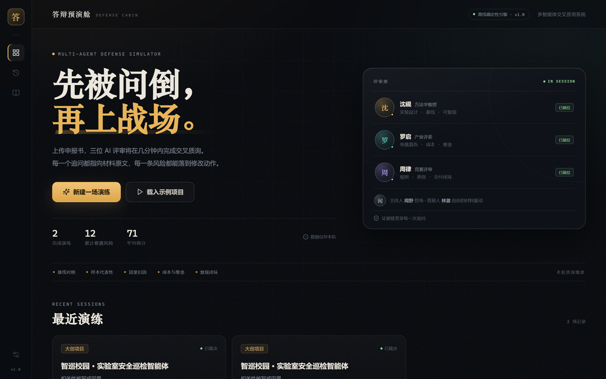

# 答辩预演舱 · Defense Cabin

> 全国高校 Vibe Coding 开发挑战赛参赛作品  
> 赛道方向：多 Agent 协同工作流看板 / 场景化轻量 RAG  
> 一句话：**把三位 AI 评审请进你的电脑，先被问倒，再上战场。**



---

## 1. 它解决什么问题

高校里的答辩准备长期停留在“自己读稿、同学旁听、导师提两句”的阶段：

- **没有人真的按评审口径逐条追问**。同学不好意思下狠手，导师时间有限。
- **材料里的弱证据不会被提前发现**。“92.4%”“提升 4 倍”“预计降低 60%”这些句子，在答辩现场往往一问就穿。
- **现有的 AI 工具只会“总结/润色”**，不会站在对立面做交叉质询，更不会把每个问题落回材料原文。
- **演练过程不可复盘**。说完就忘，下一次还是同样的坑。

「答辩预演舱」把答辩准备变成一次**可回放的压力测试**：

1. 上传申报书 / 答辩稿 / 论文（PDF、DOCX、Markdown、TXT）。
2. 系统抽取 8–12 条“可质询论点”，标注证据强度与缺口（缺基线、缺样本、因果混淆、承诺性指标、无出处）。
3. 方法学教授、产业评委、竞赛评审三位 Agent 交叉质询，答辩人 Agent 由材料驱动应答，主持人控场。
4. 生成五维风险雷达、风险清单、按 P0/P1/P2 排序的修改清单，以及可回放到段落的质询实录。
5. 一键导出 Markdown / 打印 PDF，或换“高压模式”再练一次。

**它不替你写申报书，也不预测奖项。它只做一件事：在你上台前，把最难听的问题先问一遍。**

---

## 2. 核心能力

| 能力 | 实现 |
| --- | --- |
| 多 Agent 交叉质询 | 3 位评审 + 主持人 + 答辩人替身；标准 27 轮 / 高压 31 轮，角色有独立语气与关注点 |
| 场景化轻量 RAG | 章节切块 + 中文 bigram 分词 + BM25；每条追问挂 1–2 条材料证据，可展开原文 |
| 论点级风险建模 | 7 类缺口标签（`no_baseline` / `no_sample` / `causal` / `vague` / `promise` / `no_source` / `buzzword`） |
| 确定性离线引擎 | 默认 `mock` 模式，不依赖任何 API Key 与网络；同一材料每次生成同一条质询链 |
| 真实模型可切换 | `AI_MODE=openai` 接入任意 OpenAI 兼容接口；请求失败自动回退到离线剧本 |
| 流式体验 | SSE 逐字输出、Turn 级持久化、断线重连重放、刷新不丢现场 |
| 可执行报告 | 五维评分、风险去重、修改清单（工作量/预计提分/关联论点）、Markdown 导出、打印 PDF |
| 过程可复现 | 细粒度 Git 提交、Prompt 链、Bug 修复 diff、`docs/prompts/` 与 `/making-of` 页面 |

---

## 3. 10 分钟极速复现

### 3.1 环境要求

- Node.js **≥ 20**（开发验证：Node 24）
- pnpm **≥ 9**（开发验证：pnpm 11.28.5）
- 现代浏览器（Chrome / Edge）
- 不需要 Python、数据库、Docker、任何 API Key

### 3.2 四步启动

```bash
# 1. 安装依赖（首次约 2–5 分钟，取决于网络）
pnpm install

# 2. 构建前端 + 后端（约 10 秒）
pnpm build

# 3. 单进程启动（前后端同源，推荐）
pnpm start

# 4. 打开
# http://127.0.0.1:8787
```

> 开发模式：`pnpm dev` 会同时启动 API（8787）与 Vite（5173），访问 `http://127.0.0.1:5173`。  
> 生产模式只启一个进程，静态资源由 Express 托管，评委复现更稳。

### 3.3 5 分钟演示路径

1. 首页点击 **「载入示例项目」** → 自动进入质询舱预检页。
2. 点击 **「开始交叉质询」**，观察三位评审逐字输出与右侧风险信号。
3. 点击任意 **「证据 · 章节」** 芯片，展开材料原文与 BM25 相关度。
4. 质询结束后点击 **「查看完整报告」**：五维雷达、风险清单、修改清单、逐轮回放。
5. 报告页点击 **「用高压模式再练一次」**，或右上角 **「打印 / PDF」** 导出。

### 3.4 接入真实大模型（可选）

```bash
cp .env.example .env
# 编辑 .env
AI_MODE=openai
OPENAI_BASE_URL=https://api.openai.com/v1
OPENAI_API_KEY=sk-...
OPENAI_MODEL=gpt-4o-mini
```

重启服务即可。任何 OpenAI 兼容接口（DeepSeek、通义、Moonshot、vLLM、Ollama 的 `/v1`）均可。  
**没有 Key 也完全不影响评审**：默认 mock 模式覆盖全部功能，且结果确定、可复现。

### 3.5 常见问题

| 现象 | 处理 |
| --- | --- |
| `ERR_PNPM_IGNORED_BUILDS: esbuild` | `pnpm approve-builds` 勾选 esbuild，或 `pnpm rebuild esbuild` |
| Windows 下 Vite 报 `Cannot find package 'rollup'` | 本项目已在 `pnpm-workspace.yaml` 设置 `nodeLinker: hoisted`；删除 `node_modules` 后重新 `pnpm install` |
| 端口 8787 被占用 | `PORT=8899 pnpm start` |
| 页面 404 | 先执行 `pnpm build`，确认 `apps/web/dist/index.html` 存在 |
| 想清空演示数据 | 删除 `apps/server/data/db.json` 后重启 |

---

## 4. 技术架构

```text
┌──────────────────────────────────────────────────────────────┐
│  Browser · React 18 + Vite + TypeScript                      │
│  Dashboard ── Session Room ── Report ── Making Of            │
│      │              │            │                           │
│      └──── fetch ───┴── SSE ─────┘                           │
└──────────────────────────┬───────────────────────────────────┘
                           │ /api
┌──────────────────────────▼───────────────────────────────────┐
│  Express API                                                 │
│  /projects  /sessions  /sessions/:id/events  /report.md      │
│  multer + mammoth + pdf-parse                                │
└──────────────┬──────────────────────────────┬────────────────┘
               │                              │
┌──────────────▼─────────────┐  ┌─────────────▼───────────────┐
│  Domain                    │  │  Engine                     │
│  analyze.ts  论点抽取/体检  │  │  script.ts   确定性剧本      │
│  text.ts     切块/BM25      │  │  orchestrator SSE/持久化     │
│                            │  │  scoring.ts  风险/评分/清单  │
│                            │  │  llm.ts      OpenAI 适配     │
└──────────────┬─────────────┘  └─────────────┬───────────────┘
               └──────────────┬───────────────┘
                     ┌────────▼────────┐
                     │ JSON Store      │
                     │ data/db.json    │
                     │ 原子写 + 单进程 │
                     └─────────────────┘
```

### 4.1 关键设计决策

1. **“说什么”与“怎么播”分离**  
   `script.ts` 只负责生成确定性的 `PlannedTurn[]`；`orchestrator.ts` 负责逐字流、落库、重放。  
   这样同一份材料可以稳定复现同一条质询链，也方便替换成真实 LLM。

2. **Turn 是最小可回放单元**  
   每个 `Turn` 带 `persona / kind / claimId / citations / risk`。前端据此高亮论点、挂载证据、渲染风险；刷新后从 `db.json` 恢复。

3. **SSE 先订阅、再重放**  
   避免“POST 已开始推流、EventSource 还没连上”导致丢消息；前端按 `turn.id` 去重，`turn:end` 覆盖流式占位。

4. **离线优先**  
   Mock 引擎不是“假数据占位”，而是完整的规则导演：从材料里抽真实句子、按缺口类型生成追问、按回答生成追问链。评委断网也能跑完整 27 轮。

5. **单进程交付**  
   生产模式 `pnpm start` 只启一个 Node 进程，Express 同时托管 API 与 `apps/web/dist`，减少评委环境变量与端口配置。

---

## 5. 目录结构

```text
defense-cabin/
├─ apps/
│  ├─ server/
│  │  ├─ src/
│  │  │  ├─ domain/        # 文本切块、BM25、论点抽取、示例材料
│  │  │  ├─ engine/        # 剧本、编排、评分、LLM 适配
│  │  │  ├─ routes.ts      # REST + SSE + 上传 + 导出
│  │  │  ├─ store.ts       # JSON 持久化（原子写）
│  │  │  └─ index.ts
│  │  └─ data/             # 运行时数据（db.json，已 gitignore）
│  └─ web/
│     └─ src/
│        ├─ pages/         # Dashboard / SessionRoom / Report / MakingOf
│        ├─ components/    # Avatar / Radar / ScoreRing / Shell / Modal
│        ├─ data/          # 研发现场时间线
│        ├─ api.ts
│        └─ styles.css     # 设计系统（无 UI 框架依赖）
├─ packages/shared/        # 前后端共享类型与 Persona 常量
├─ docs/
│  ├─ prompts/             # Prompt 链（5 个核心迭代）
│  ├─ architecture.md
│  ├─ competition-mapping.md
│  └─ technical-report.pdf # 技术文档（≤30 页）
├─ samples/                # 示例申报书
├─ scripts/                # 截图、E2E、PDF/视频构建
└─ screenshots/            # 演示截图
```

---

## 6. 数据模型（核心）

```ts
interface Claim {
  id: string;
  text: string;
  kind: '创新' | '方法' | '数据' | '应用' | '团队' | '承诺';
  strength: 'strong' | 'medium' | 'weak';
  issues: IssueCode[];       // no_baseline / no_sample / causal / ...
  section: string;
  chunkId: string;
  score: number;
}

interface Turn {
  id: string;
  round: number;
  persona: 'host' | 'method' | 'industry' | 'judge' | 'presenter';
  kind: 'opening' | 'question' | 'answer' | 'followup' | 'verdict' | 'summary' | 'system';
  text: string;
  citations: Citation[];
  claimId?: string;
  theme?: string;
  risk?: 'high' | 'medium' | 'low';
}

interface Session {
  id: string;
  projectId: string;
  status: 'ready' | 'running' | 'completed';
  turns: Turn[];
  scores: DimensionScore[];
  risks: RiskItem[];
  revisions: Revision[];
  overall: number;
}
```

完整类型见 `packages/shared/src/index.ts`。

### 6.1 API 一览

| Method | Path | 说明 |
| --- | --- | --- |
| GET | `/api/health` | 健康检查 + 当前 AI 模式 |
| GET | `/api/stats` | 首页统计 |
| POST | `/api/projects` | multipart 上传材料，返回解析后的项目与论点 |
| GET | `/api/projects/:id` | 项目详情（含 chunks / claims / health） |
| POST | `/api/sessions` | 创建演练（`projectId` / `intensity` / `speed`） |
| POST | `/api/sessions/:id/start` | 启动质询 |
| GET | `/api/sessions/:id/events` | SSE 事件流（`turn:start/delta/end`、`report`、`done`） |
| GET | `/api/sessions/:id/report.md` | 导出 Markdown 报告 |
| POST | `/api/demo` | 创建示例项目 + 演练（可自动开始） |

---

## 7. 意图控制策略（摘要）

完整版见 `docs/architecture.md` 与技术文档第 8 章。

1. **角色卡片约束**：每个 Agent 有固定 `title / focus / bio / 语气规则`，Prompt 只允许它问“自己职责内”的问题。
2. **证据先行**：任何追问必须绑定一个 `claimId`，由 BM25 检索出原文片段后才能进入台词；没有证据就不生成问题。
3. **结构化剧本**：先生成 `PlannedTurn[]`（谁、问什么、引用哪条论点、风险级别），再交给编排器流式播放。LLM 只负责“把台词说得更像人”，不负责决定结构。
4. **上下文预算**：每次 LLM 调用只带“项目摘要 + 当前论点 + 最近 4 轮”，避免长上下文漂移；超时/失败自动回退 mock。
5. **可证伪输出**：评分必须能解释到具体风险项；修改清单必须带 `claimId` 与预计提分，不允许“加强创新性”这类空话。

---

## 8. 可复现性

- **确定性**：默认 mock 模式无随机数；同一材料、同一强度 → 同一剧本、同一评分。
- **细粒度提交**：每个功能/修复独立 commit，commit message 带模块前缀，可在 `git log` 中回放到具体步骤。
- **Prompt 链**：`docs/prompts/01-scope.md` ~ `05-build.md`，包含原始意图、AI 产出摘要、翻车现场、修复方式。
- **Bug 复现**：每个 bug 都记录了触发条件与修复 diff 所在文件。
- **10 分钟路径**：见第 3 节；无需外部服务。
- **数据隔离**：上传材料只写本机 `apps/server/data/`，不发送第三方；mock 模式无任何出站请求。

> 说明：`docs/prompts/` 是对本次开发会话的结构化还原（用户指令 + AI 关键输出 + 修复动作），不是聊天工具的逐字导出文件。若赛事要求原始导出，可将本文件与工具截图一并提交；`/making-of` 页面提供了可视化的同一链路。

---

## 9. 测试

```bash
pnpm test          # Vitest：论点抽取 / 年份保留 / promise 兜底 / 风险去重 / 分数边界 / 剧本轮数
pnpm e2e           # Playwright：完整走通 首页 → 预检 → 质询 → 报告
```

开发期验证结果：

- 单元测试 **7/7 通过**
- E2E：无 console error，质询完整跑完，报告正常渲染
- 示例项目：标准模式 27 轮 / 高压模式 31 轮；评分 71；6 条风险（5 高 / 1 中）

---

## 10. 评审标准对标

| 评分维度 | 权重 | 本作品对应证据 |
| --- | ---: | --- |
| 过程可复现性与演进链路 | 25% | 细粒度 Git、5 个 Prompt 链、3 个真实 Bug 修复、`/making-of` 页面、10 分钟复现 |
| 解题有效性与实用价值 | 25% | 真实校园答辩痛点；材料→质询→报告→再练的完整闭环；示例项目可直接替换 |
| 方法创新性与意图控制 | 20% | 多 Agent 交叉质询 + 论点级 RAG；剧本/播放分离；角色约束与证据绑定 |
| 工程质量与架构设计 | 15% | 前后端分离、共享类型、原子写、SSE 重放、单元测试、无数据库依赖 |
| 用户体验与产品精细度 | 15% | 暗色评审舱视觉、逐字流、证据芯片、雷达动画、响应式、打印样式 |

---

## 11. 已知限制

1. **示例材料是虚构的**（“智巡校园”项目），仅用于演示；真实使用请上传自己的申报书。
2. Mock 引擎是规则导演，不等于真实大模型的开放推理；它保证“可复现”，不保证“比 GPT-4 更聪明”。
3. 扫描版 PDF 无法抽取文字，需要先 OCR。
4. 单进程 JSON 存储适合个人/小团队；多人并发需要换 SQLite/Postgres。
5. 评分是演练参考，不是奖项预测；不同学科、不同赛道的评审口径仍需人工校准。

---

## 12. 材料索引

| 材料 | 位置 |
| --- | --- |
| 演示截图 | `screenshots/` |
| 技术文档 PDF | `docs/technical-report.pdf` |
| 演示视频 | `video/答辩预演舱-演示视频.mp4` |
| Prompt 链 | `docs/prompts/` |
| 架构说明 | `docs/architecture.md` |
| 评审对标 | `docs/competition-mapping.md` |
| 示例材料 | `samples/智巡校园-实验室安全巡检智能体.md` |

---

## License

MIT。示例材料与“智巡校园”项目名称仅为演示虚构，不涉及真实学校数据。
